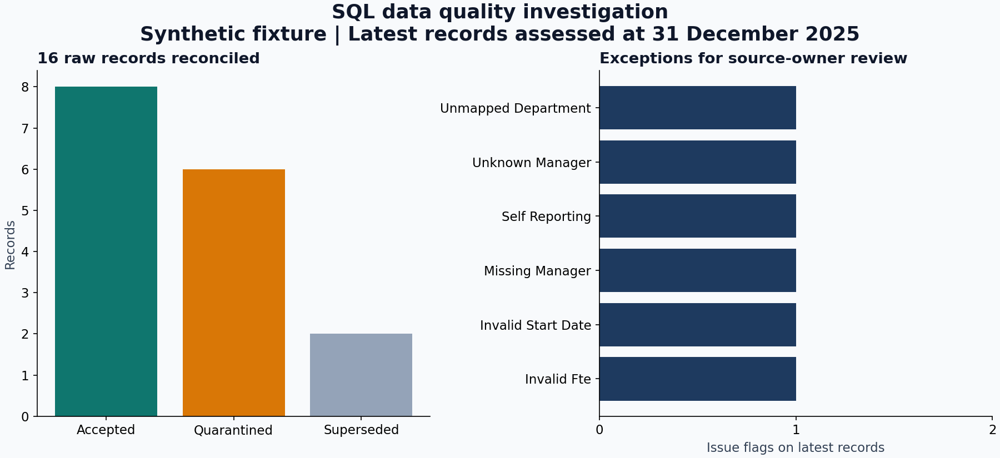

# Abhijeet Singh Thakur | Data Analytics Portfolio

Auckland, New Zealand. My background includes public-sector programme reporting,
workforce data, stakeholder engagement and data quality. My core tools are SQL,
Excel and Power BI.

This portfolio contains **AI-assisted demonstration projects with synthetic data**.
They illustrate analytical approaches relevant to my background. They are not
employer deliverables, client case studies, or evidence of measured workplace savings.

## Projects

| Project | Business question | Evidence available |
| --- | --- | --- |
| [Workforce capacity and recruitment](projects/01-workforce-reporting) | Where are capacity gaps and long-open vacancies? | SQL, 120-position register, calculated results, static preview, Power BI build guide and DAX |
| [SQL data quality investigation](projects/02-sql-data-quality) | Which employee records can be used, and which need source-owner review? | Runnable SQLite queries, version selection, mapping, exception log and reconciliation |
| [Hospitality profitability](projects/03-hospitality-profitability) | How do channel fees and seasonal demand affect operating surplus? | 144 synthetic sales records, SQL, formula-based Excel workbook, chart and findings |

### Workforce capacity

### SQL data quality

### Hospitality profitability

## Start here

- **Recruiters:** open a project above, then read its findings and inspect the code or workbook.
- **Learning:** follow the [step-by-step guide](docs/LEARNING_GUIDE.md).
- **Reproduce:** install Python 3.10+ and run `python scripts/build_portfolio.py` from the repository folder. The core build needs no third-party packages or network access.
- **Rebuild PNG previews:** optionally install `requirements.txt`, then run `python scripts/build_portfolio.py --charts`.
- **Excel:** download [hospitality_analysis.xlsx](projects/03-hospitality-profitability/hospitality_analysis.xlsx). GitHub does not display the workbook as a spreadsheet.

## Delivery status

SQL analyses, datasets, exported results and static previews are included. The Excel
workbook contains editable formulas and a native chart. It has been recalculated
and checked against SQL controls with an automated spreadsheet engine.

The workforce preview is generated with Matplotlib. It is **not a Power BI screenshot**.
A native `.pbix` report has not been built or verified. The Power BI import/model
instructions and DAX are supplied for completion in Power BI Desktop. The Excel file
has not been opened in Microsoft Excel in this build environment.

## Method and provenance

Data are generated locally by [build_portfolio.py](scripts/build_portfolio.py).
The workforce example is a position-based snapshot at 31 December 2025. The SQL
quality example is a deliberately small test fixture. The hospitality example
uses a fixed seed and illustrative CY2025 assumptions in NZD excluding GST.
The three datasets describe separate fictional situations and should not be joined.

Code, data and documentation were drafted with AI assistance. Personal review,
Power BI implementation and learning exercises are tracked in
[REVIEW_CHECKLIST.md](docs/REVIEW_CHECKLIST.md). These exercises are intentionally
left for the portfolio owner; completion is not claimed.

## Professional context

My work background includes Waikato Waters and public-sector reporting roles.
These examples use fictional records and generic business problems. No employer
data, internal documents, employee salary records, or personal contact details are included.

## Technical references

- [Microsoft: model relationships](https://learn.microsoft.com/en-us/power-bi/transform-model/desktop-relationships-understand)
- [Microsoft: star schema guidance](https://learn.microsoft.com/en-us/power-bi/guidance/star-schema)
- [GitHub: profile customisation](https://docs.github.com/en/account-and-profile/how-tos/profile-customization)
- [SQLite: window functions](https://www.sqlite.org/windowfunctions.html)

See [VALIDATION.md](docs/VALIDATION.md) for checks and limits.
