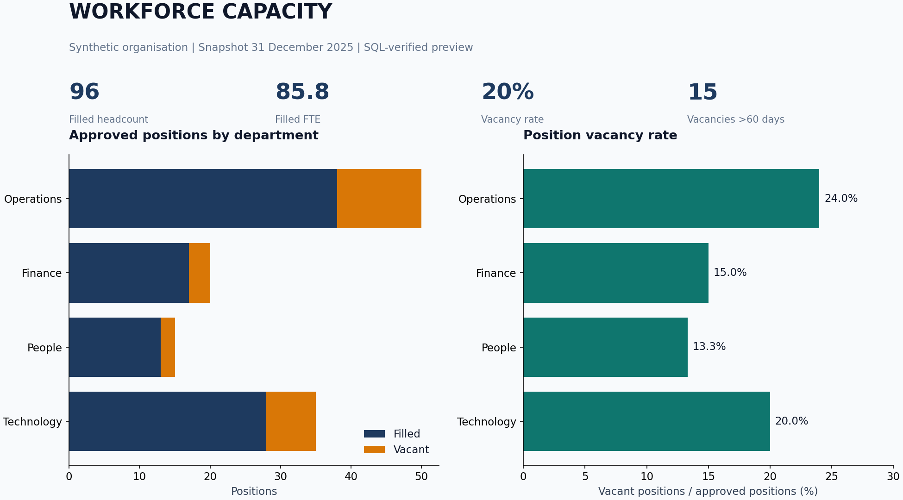

# Workforce capacity and recruitment

**Question:** Which departments have the greatest capacity gaps, and which vacancies
have been open for more than 60 days?

Synthetic demonstration. Snapshot: **31 December 2025**.

## Findings

120 approved positions comprise 96 filled positions and 24 vacancies. Filled capacity
is 85.8 FTE and vacant capacity is 19.8 FTE. Position vacancy rate is 20%; 15 vacancies
have been open for more than 60 days. Operations has the most vacancies (12) and a
24% position vacancy rate. See [findings](outputs/findings.md) and
[department results](outputs/department_summary.csv).

## Files and workflow

1. [Data dictionary](DATA_DICTIONARY.md): understand grain and definitions first.
2. `data/departments.csv`: four department lookup records.
3. `data/positions.csv`: 120 approved positions, including vacant positions.
4. `data/recruitment.csv`: 24 requisitions, one for each vacancy.
5. [analysis.sql](analysis.sql): conditional aggregation for headcount, FTE and vacancy rates.
6. [Power BI guide](POWER_BI_GUIDE.md) and [measures.dax](measures.dax): build the native report.
7. [Expected metrics](outputs/expected_metrics.json): reconcile your report before sharing it.

The static preview is built with Matplotlib from SQL outputs. Native Power BI work
remains to be completed in Desktop; no `.pbix` or published report is claimed.

## Decisions and limitations

- FTE measures capacity. Headcount counts people. They answer different questions.
- In this simplified model every filled position has one unique employee. Multi-position
  employees and job sharing would require a separate employee-position assignment table.
- A vacant approved role still contributes to the vacancy-rate denominator.
- A long-open vacancy is an investigation prompt, not proof that recruitment is ineffective.
- A single snapshot cannot establish headcount trends, attrition or hiring duration.
- The SQL uses SQLite date functions. SQL Server requires equivalent `DATEDIFF` logic.

**Suggested action:** review aged Operations vacancies with hiring managers and consider
service criticality and recruitment stage before prioritising work.
