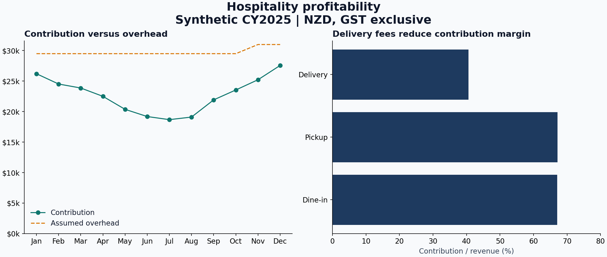

# Hospitality sales and profitability

**Question:** How do seasonal demand, food costs and channel fees affect operating surplus?

Synthetic calendar year 2025. All amounts **NZD, GST exclusive**.

## Findings

Annual revenue is **$465,948**. Contribution after food cost and channel fees is
**$272,730.77**. Assumed annual overhead is **$357,000**, giving an operating loss of
**$84,269.23** before owner pay, interest, depreciation and income tax.
The fixture therefore prompts a review of cost structure and channel economics.
It does not support a claim that sales growth alone creates a profitable business.

See [full findings](outputs/findings.md), [monthly results](outputs/monthly_summary.csv)
and [channel comparison](outputs/channel_summary.csv).

## Download and use the workbook

Open [hospitality_analysis.xlsx](hospitality_analysis.xlsx), then use GitHub's Download
raw file button. Open the downloaded file in Excel.

| Sheet | Purpose | What to inspect |
| --- | --- | --- |
| Monthly results | Annual totals, monthly calculation and native chart | Contribution, overhead and operating surplus |
| Sales calculation | Row-level calculation linked to source | Revenue, food cost, fee, gross profit, contribution and margin |
| Inputs | 144 source rows and 12 overhead amounts | Blue numeric inputs with amber fill are editable |

The workbook has been calculated using an automated spreadsheet engine and reconciled
to SQL. It has not been opened in Microsoft Excel in this environment. Check the native
chart and recalculate after opening it on your computer.

## Understand the calculations

- Revenue = units x unit price.
- Food cost = units x unit food cost.
- Channel fee = revenue x fee rate, rounded to cents **for each source row**, then summed.
  SQL and Excel express the rate as integer basis points before rounding (1.5% = 150 bp)
  so half-cent values round consistently. Fee-rate inputs support four decimal places.
- Gross profit = revenue - food cost.
- Contribution = gross profit - channel fee.
- Contribution margin = contribution / revenue. Use a weighted total, not an average of row margins.
- Operating surplus = contribution - assumed overhead.

The source grain is **month x channel x category**, not individual transactions.
Fee rates: 1.5% for dine-in/pickup, 28% for delivery. These are illustrative assumptions.
Seasonality and quantities are generated with seed 42. They are not Auckland benchmarks.
Overhead is $29,500 a month, rising to $31,000 in November and December.

`data/sales.csv` contains month, channel, category, units, unit_price,
unit_food_cost and fee_rate. `data/overheads.csv` contains month and overhead.
`data/workbook_inputs.json` repeats the same typed inputs for the workbook builder.

## Practise and explain

1. Note baseline annual contribution and operating surplus.
2. Change the first source row's units by +10. Revenue should rise by $240.
3. Restore units. Change one delivery fee from 28% to 25% and trace the fee reduction.
4. Restore the fee. Reduce one month's overhead by $1,000; that month's surplus should
   improve by exactly $1,000, while revenue and contribution remain unchanged.
5. Restore all inputs. Compare annual controls with `outputs/expected_metrics.json`.

Changing the Excel file does not update the committed SQL CSV outputs. Restore the
baseline workbook before comparing it with those outputs, or deliberately update
the generator and rebuild the pipeline for a new version.

The workbook formulas use bounded 144-row ranges. To add source records, extend the
calculation rows, table ranges and summary SUMIFS ranges. Adding a thirteenth month
also requires extending overhead inputs, monthly output rows and chart sources.

## Limits

This is an illustrative operating analysis. It excludes owner remuneration, debt costs,
depreciation, income tax, capex and working capital. It is not a cash-flow forecast,
net-profit calculation or actual business valuation. Demand and costs are assumed.

## Rebuild

`python scripts/build_portfolio.py` regenerates data and SQL outputs. It does not
overwrite your Excel edits. Workbook regeneration uses
`scripts/build_workbook.mjs` and the documented `@oai/artifact-tool` dependency;
see that script's header. You can use the existing workbook without Node.
